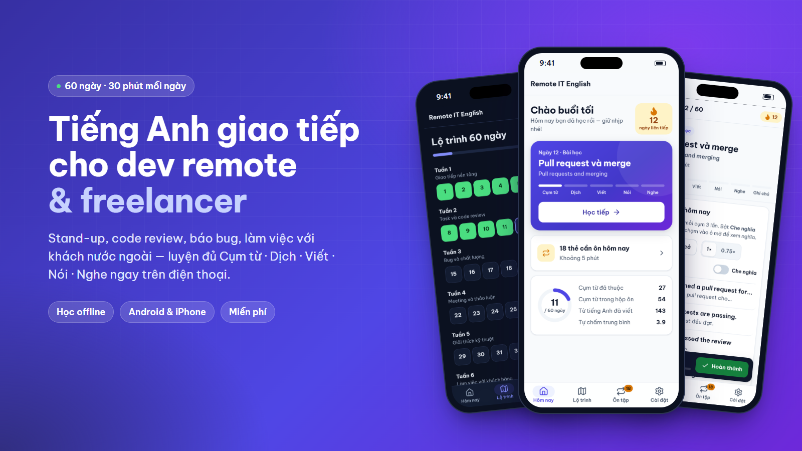
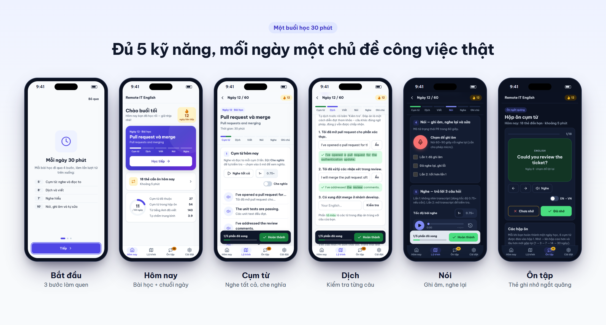
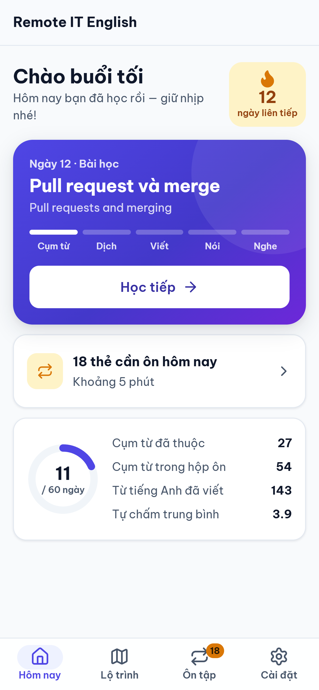
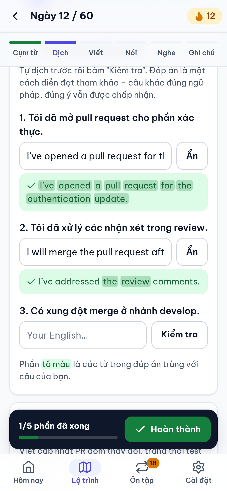
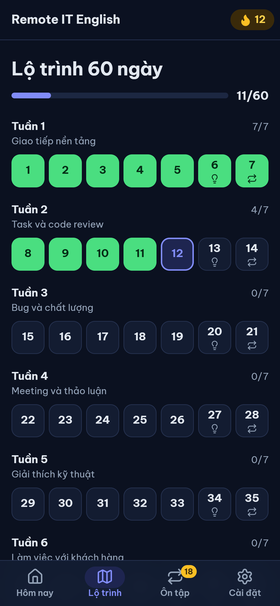

<p align="center">
  
</p>

<h1 align="center">Remote IT English</h1>

<p align="center">
  <b>Nói tiếng Anh tự tin trong stand-up, code review và với khách nước ngoài sau 60 ngày, mỗi ngày 30 phút.</b><br>
  App học miễn phí cho lập trình viên làm remote và freelancer. Chạy trên Android, iPhone và máy tính, học được cả khi không có mạng.
</p>

<p align="center">
  <a href="https://nguyenhoangtin1404.github.io/remote-english-60-day/"><b>▶ Mở web app</b></a>
  &nbsp;·&nbsp;
  <a href="https://github.com/nguyenhoangtin1404/remote-english-60-day/releases/latest/download/RemoteITEnglish.apk"><b>⬇ Tải APK Android</b></a>
  &nbsp;·&nbsp;
  <a href="#cài-lên-điện-thoại">Hướng dẫn cài</a>
</p>

---

## Đọc hiểu tài liệu thì được, nhưng mở mic trong daily là khựng?

Phần lớn dev Việt đọc docs tiếng Anh hằng ngày, nhưng khi phải **báo tiến độ trong stand-up, góp ý một pull request hay giải thích với khách vì sao task bị trễ** thì không biết dùng câu nào cho tự nhiên.

Remote IT English không dạy ngữ pháp chung chung. Mỗi ngày bạn luyện **6 cụm từ dùng thật trong công việc IT** qua đủ 5 kỹ năng, theo đúng tình huống bạn sẽ gặp vào hôm sau.

## Bạn nhận được gì

| | |
|---|---|
| **Học đúng việc mình làm** | 40 bài theo tình huống thật: giới thiệu bản thân với team, ước tính task, báo trễ hạn, code review, báo bug, họp, làm rõ phạm vi với khách, bàn giao, phỏng vấn remote. |
| **Đủ 5 kỹ năng trong 30 phút** | Cụm từ → Dịch → Viết → Nói → Nghe. Thanh bước trên đầu bài cho biết bạn đang ở đâu và còn phần nào chưa làm. |
| **Nhớ lâu, không học vẹt** | Xong mỗi ngày, 6 cụm từ vào **hộp ôn ngắt quãng**: nhớ thì lâu mới gặp lại (1 → 3 → 7 → 14 → 30 ngày), quên thì ôn lại ngày mai. |
| **Giữ được nhịp học** | **Chuỗi ngày học** với 1 ngày nghỉ mỗi tuần (giống ngày Pro-tip), nên lỡ một hôm vẫn không mất chuỗi. |
| **Học mọi lúc, kể cả offline** | 264 cụm từ có audio giọng bản xứ, 44 bài nghe có bản chậm 0.75×. Tải audio một lần là học được trên xe, trên máy bay. |
| **Riêng tư, không cần tài khoản** | Tiến độ lưu ngay trên máy bạn. Xuất ra file để sao lưu hoặc chuyển sang máy khác. |

<p align="center">
  
</p>

## Một buổi học 30 phút

| Thời gian | Bạn làm gì | App giúp gì |
|---|---|---|
| **5 phút: Cụm từ** | Nghe và đọc to 6 cụm từ, mỗi cụm 3 lần | **Nghe tất cả** phát lần lượt từng cụm, chế độ Shadowing có khoảng lặng để nhại theo, **Che nghĩa** để tự kiểm tra |
| **8 phút: Dịch và viết** | Dịch 3 câu, viết một đoạn ngắn dùng ít nhất 3 cụm từ | **Kiểm tra** từng câu và tô các từ bạn viết khớp đáp án; tự nhận ra cụm từ bạn đã dùng |
| **7 phút: Nghe** | Nghe một đoạn hội thoại và trả lời 3 câu hỏi | Trình phát có tua, lùi 5 giây, tốc độ 0.75×, transcript để đối chiếu |
| **10 phút: Nói** | Ghi âm 60–90 giây, nghe lại, sửa lỗi, nói lại | Nút ghi âm một chạm, mỗi lần ghi là một thẻ để so sánh với lần trước |

<table>
  <tr>
    <td align="center" width="33%"><br><b>Hôm nay</b><br><sub>Bài tiếp theo, chuỗi ngày, số thẻ cần ôn</sub></td>
    <td align="center" width="33%"><br><b>Dịch có chấm ngay</b><br><sub>Thấy câu mình đúng tới đâu</sub></td>
    <td align="center" width="33%"><br><b>Lộ trình 60 ngày</b><br><sub>Có chế độ tối cho buổi học đêm</sub></td>
  </tr>
</table>

## Lộ trình 9 tuần

Mỗi tuần có 5 ngày học, 1 ngày nghỉ đọc **Pro-tip** về văn hoá làm việc remote và 1 ngày **ôn tập**. Tuần cuối là 4 bài **Capstone** tổng hợp.

| Tuần | Chủ đề | Tuần | Chủ đề |
|---|---|---|---|
| 1 | Giao tiếp nền tảng | 6 | Làm việc với khách hàng |
| 2 | Task và code review | 7 | Quản lý khách & bàn giao |
| 3 | Bug và chất lượng | 8 | Teamwork và phỏng vấn |
| 4 | Meeting và thảo luận | 9 | Capstone tổng hợp |
| 5 | Giải thích kỹ thuật | | |

Ngày đầu và cuối khoá, bạn tự chấm 8 năng lực cốt lõi (stand-up, báo blocker, giải thích kỹ thuật, làm rõ phạm vi với khách…) để thấy rõ mình tiến bộ bao nhiêu.

## Cài lên điện thoại

**Android: APK, chạy offline hoàn toàn**
1. Mở [link tải APK](https://github.com/nguyenhoangtin1404/remote-english-60-day/releases/latest/download/RemoteITEnglish.apk) trên điện thoại.
2. Mở file vừa tải → cho phép *Cài ứng dụng không rõ nguồn gốc* → **Cài đặt**. Nếu Play Protect cảnh báo, chọn *Vẫn cài đặt* (đây là bản chưa đưa lên Google Play).
3. Audio đã có sẵn trong app. Cài đè bản mới lên bản cũ vẫn giữ nguyên tiến độ.

**iPhone, Android hoặc máy tính: web app**
1. Mở **https://nguyenhoangtin1404.github.io/remote-english-60-day/**
2. Android (Chrome): vào **Cài đặt → Cài app vào máy**. iPhone (Safari): nút **Chia sẻ → Thêm vào MH chính**.
3. Vào **Cài đặt → Tải audio học offline** (~60MB, nên dùng Wi‑Fi) để học khi không có mạng.

## Câu hỏi thường gặp

<details><summary><b>Có mất phí không?</b></summary>

Không. App miễn phí, không quảng cáo, không cần đăng ký tài khoản.
</details>

<details><summary><b>Trình độ của mình có theo được không?</b></summary>

Phù hợp với người đã đọc được tài liệu tiếng Anh nhưng còn ngập ngừng khi nói và viết trong công việc. Mỗi cụm từ đều có nghĩa tiếng Việt, câu dịch có đáp án tham khảo, bài nghe có bản chậm và transcript.
</details>

<details><summary><b>Tiến độ học lưu ở đâu? Đổi điện thoại thì sao?</b></summary>

Tiến độ lưu trên máy bạn, không gửi lên máy chủ nào. Vào **Cài đặt → Xuất tiến độ** để lưu ra file (bản APK mở bảng Chia sẻ để gửi qua Drive, Zalo hoặc Gmail), rồi **Nhập tiến độ** ở máy mới. App sẽ nhắc khi bạn đã lâu chưa sao lưu.
</details>

<details><summary><b>Lỡ một ngày có mất chuỗi không?</b></summary>

Không. Cứ mỗi 7 ngày bạn được nghỉ 1 ngày mà chuỗi vẫn giữ, giống ngày Pro-tip trong lộ trình. Một ngày được tính là đã học khi bạn hoàn thành một bài hoặc ôn ít nhất một thẻ.
</details>

<details><summary><b>Bản ghi âm phần Nói có được lưu không?</b></summary>

Bản ghi chỉ nằm trong trang đang mở để bạn nghe lại và so sánh, không tự lưu và không gửi đi đâu. Bấm **Tải về** nếu muốn giữ.
</details>

---

<p align="center">
  <b>Bắt đầu ngày 1 ngay hôm nay: chỉ mất 30 phút.</b><br><br>
  <a href="https://nguyenhoangtin1404.github.io/remote-english-60-day/"><b>▶ Mở web app</b></a>
  &nbsp;·&nbsp;
  <a href="https://github.com/nguyenhoangtin1404/remote-english-60-day/releases/latest/download/RemoteITEnglish.apk"><b>⬇ Tải APK Android</b></a>
</p>

---

## Dành cho người phát triển

Vanilla JS, không cần bước build: `index.html`, `style.css`, `app.js`, nội dung bài học trong `data.js`. Bản Android đóng gói bằng Capacitor 6.

```bash
npm install
npm run serve                      # chạy web tại http://localhost:8080
npm run apk                        # build APK debug (cần Android SDK + JDK 17)
node scripts/build-assets.js       # sinh lại font tự host + SVG sprite icon
node scripts/marketing-shots.js    # chụp màn hình và dựng ảnh giới thiệu trong docs/images (cần Chrome)
```

Push lên `main` thì GitHub Actions tự deploy bản web lên GitHub Pages. Kế hoạch giao diện xem ở [docs/UI-UX-UPGRADE-PLAN.md](docs/UI-UX-UPGRADE-PLAN.md).
